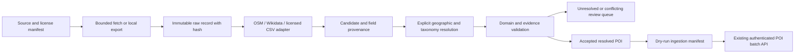

# Acquisition design

Extend `crawler_service/app` with a capability package for acquisition. Do not introduce a competing service. Source adapters parse licensed OSM records and Wikidata entity JSON into shared candidates. Fetching is separate from parsing so fixtures, authorized exports and bounded network fetches use the same code.

Use a registry only for selecting an adapter by declared source type. Deterministic extraction precedes any LLM use. Every raw record has source identity, retrieval time, license and hash. Preserve conflicting values rather than last-write-wins enrichment. Exact source identity gives repeatable imports; cross-source similarity only creates review candidates. A reviewed explicit equivalence mapping can consolidate sources after verification.

Review is the default for missing/ambiguous coordinates, unknown category, unresolved administrative area, area geometry or conflicting evidence. Accepted records require explicit mapping to the existing closed category catalog and verified administrative context. Do not infer districts from bounding boxes alone. Geography supplied by the source is labelled source-supported until independently reviewed.

Persist raw, candidate, decision and accepted JSONL separately under a versioned output directory. Writes must be atomic and reprocessing idempotent. No automatic live ingestion: create a dry-run manifest, snapshot graph, then use the existing authenticated batch contract. Keep original thesis dataset separate from expansion.

Fetch safeguards: HTTPS, bounded response size/timeouts/retries, descriptive user agent, allowed source hosts, no credentials in URLs, and no private-network targets. Cache immutable fetched samples. No arbitrary URL fetch through the application. A missing permission manifest yields a rejection rather than a network request.
