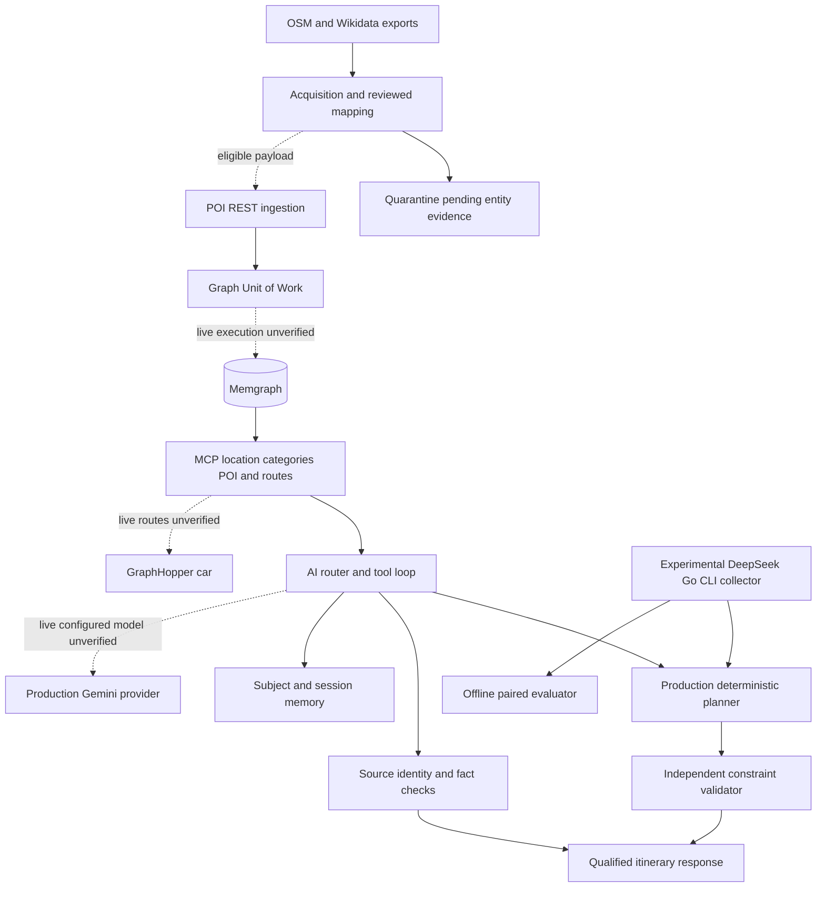

# Current architecture and verification boundaries

Updated2026-10-16 from current source and independent QA. This is the repaired architecture; the initial audit is retained in Git/history and milestone evidence. A component shown below can exist in code without a verified live deployment.

The acquisition module reads OSM/Wikidata source exports, preserves source hashes and entity facts, resolves administrative/category evidence through reviewed mappings, and emits accepted or quarantined records. The actual expansion run retained30OSMnodes and2Wikidataentities, all32quarantined and0accepted. Export parsing is operational on local sources; the source-specific fetch attempts and local PBF extraction are separate evidence. Collected expansion has not been imported into a live graph. OC026R1 synthetic/real state isolation passed140independenttests: immutable dataset/class scope and every loaded entry are validated before outputs. Keep separate state directories and preserve legacyv2 state; migration remains a separate reviewed task.

POI identifiers are stable and supplied nonblank identifiers are preserved. Coordinates are validated. Ingestion counts canary and remainder consistently, uses fresh transactions on retry and retains bounded process-local SSE replay. Single-POI mutation replaces incident spatial edges within its transaction; bulk ingestion reports its post-write spatial stage separately. Stored radius conflicts and missing legacy radius metadata gate application rebuilds. Independent fake-driver/HTTP tests support these contracts; live Cypher, concurrent global-radius consistency and recovery across workers remain unverified.

MCP retrieval combines structured geographic/category conditions before limits. Administrative ambiguity is retained. Route tools require all ordered coordinates and preserve directed route timing evidence; only the configured car profile is supported. The AI tool loop consumes actual tool result contracts, binds POI identity/source facts and rejects unsupported location/fact claims. Process memory and optional SQLite profiles are scoped to authenticated subject/session with bounded leases/history and deletion/version controls. These paths have in-process tests with fake model/MCP connectors; no combined live model/graph/routing result has been verified.

The itinerary endpoint integrates the production scheduler and independent validator through a typed adapter. Required categories, day/meal windows and cumulative budget constraints are preserved. Menu prices are not converted to visit costs. Missing routes/hours/costs remain unknown. A heuristic no-plan does not establish mathematical infeasibility. Independent255AI and126planner tests verify the mocked integration at their milestone; they are not scientific observations.

Production AI still uses its configured Gemini path. The user authorized OpenCode Go DeepSeek Flash for experimental calls. The experimental collector invokes the same production scheduler through a documented category-weight mapping, preserves raw attempts and immutable frozen run plans, and exports only observations with sufficient provenance. Its96independent tests and evaluator67tests are engineering evidence. Two bounded DeepSeek attempts timed out with empty event streams and0validrecords. Registered OpenCode Go credentials were observed without reading or exposing their values; successful provider operation is not established.

Backend draft persistence was implemented in OC027 and passed34independenttests, but simulated SQLite failure escaped error handling and readiness remained true. OC027R1 is correcting those boundaries; the backend is not yet independently accepted or included in the verified flow. Its boundary is authenticated user-owned draft save/list/get/delete preserving the generated validation status. Saving a draft does not certify it as feasible. No frontend operational claim is made.

The isolated integration Compose file is configuration-validated with separate loopback ports and volumes. Docker Linux engine remains unavailable in the last check. No successful container build/start, graph import or live end-to-end deployment is claimed. The Word manuscript is a27page working draft with figures pending and incomplete experiments; it does not satisfy the final60–70page thesis requirement.

Evidence: docs/project/EVIDENCE_REGISTER.md E013–E039, INDEPENDENT_QA.md and per-task handoffs. Counts overlap; do not sum them into a scientific sample size. Current source and latest independent acceptance take precedence over earlier audit descriptions.
